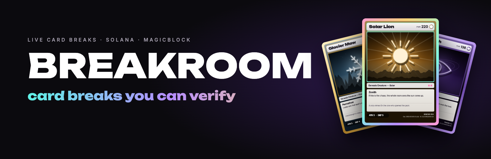
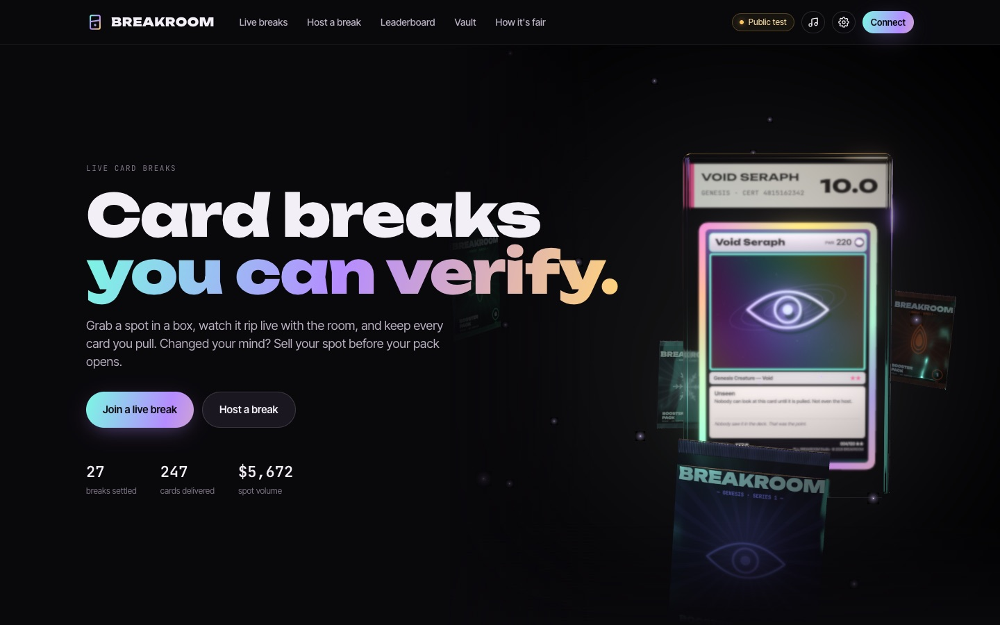
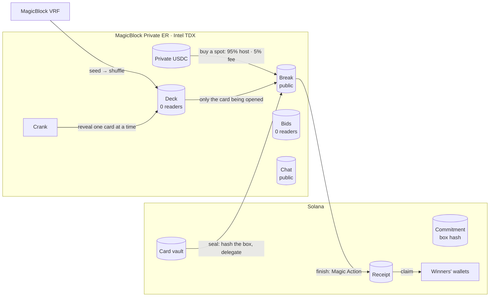
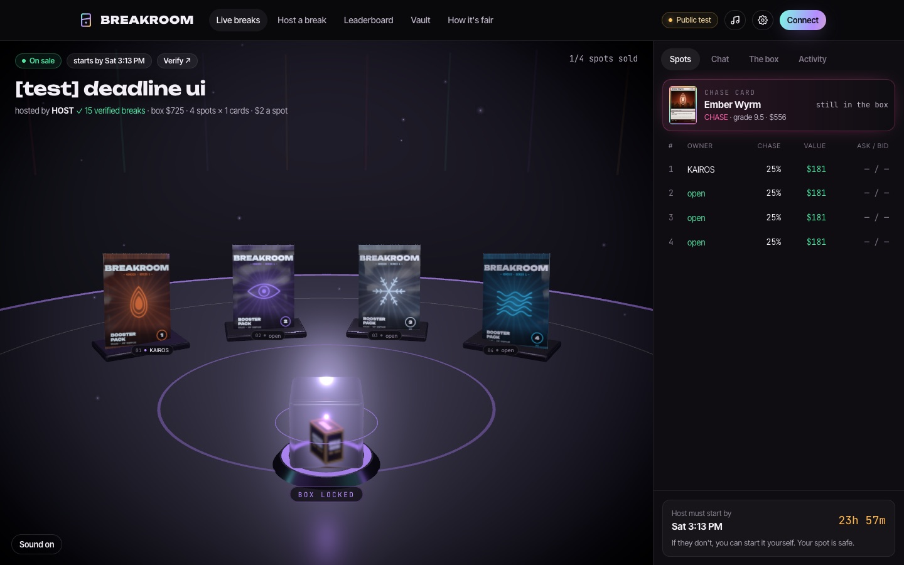
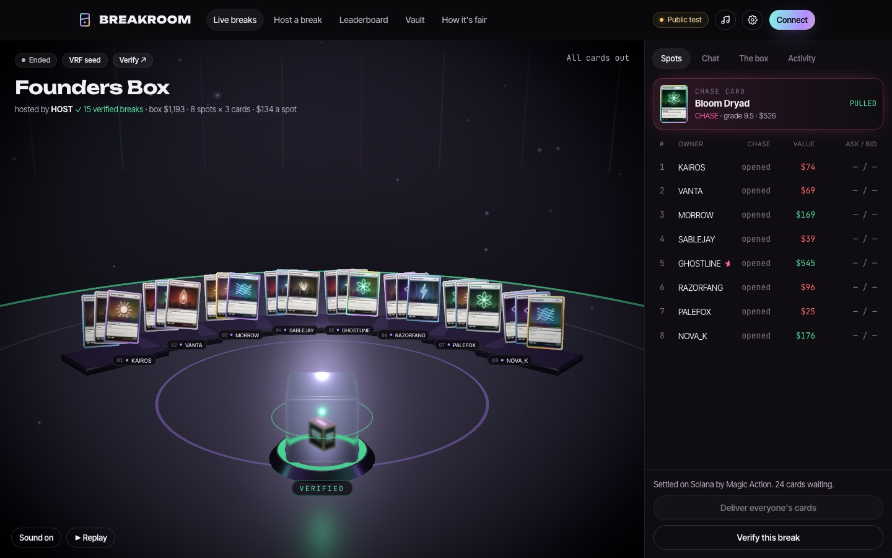
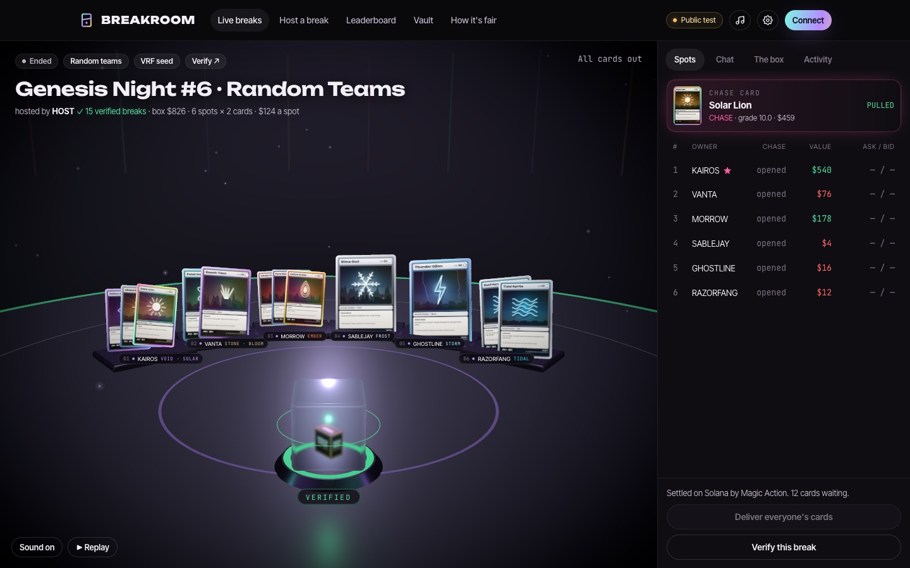
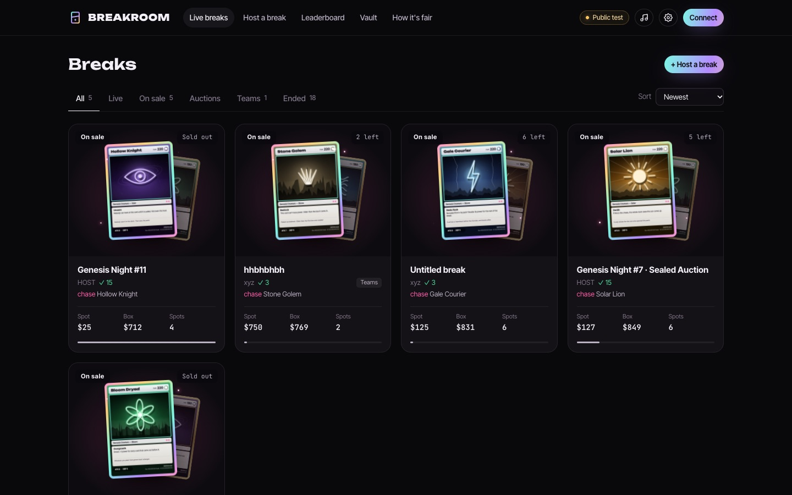
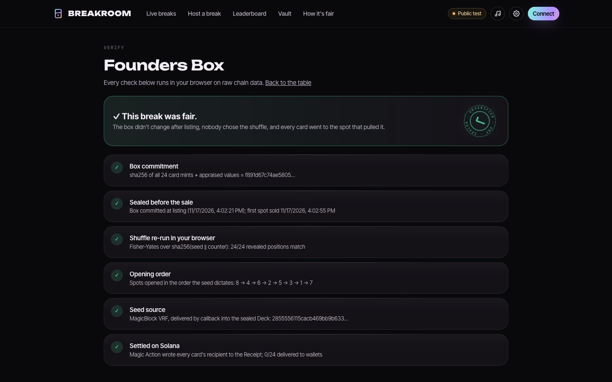
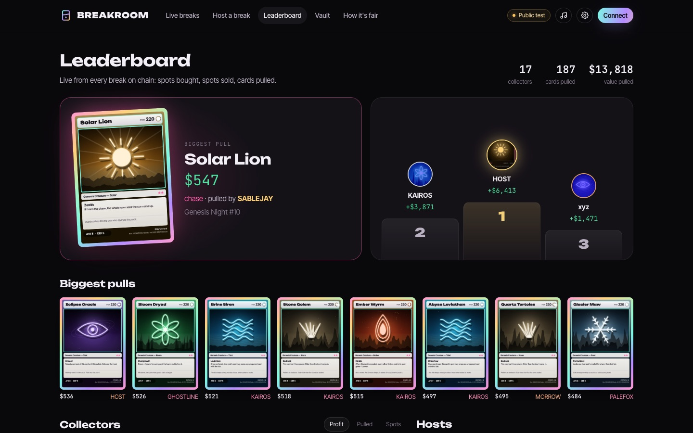
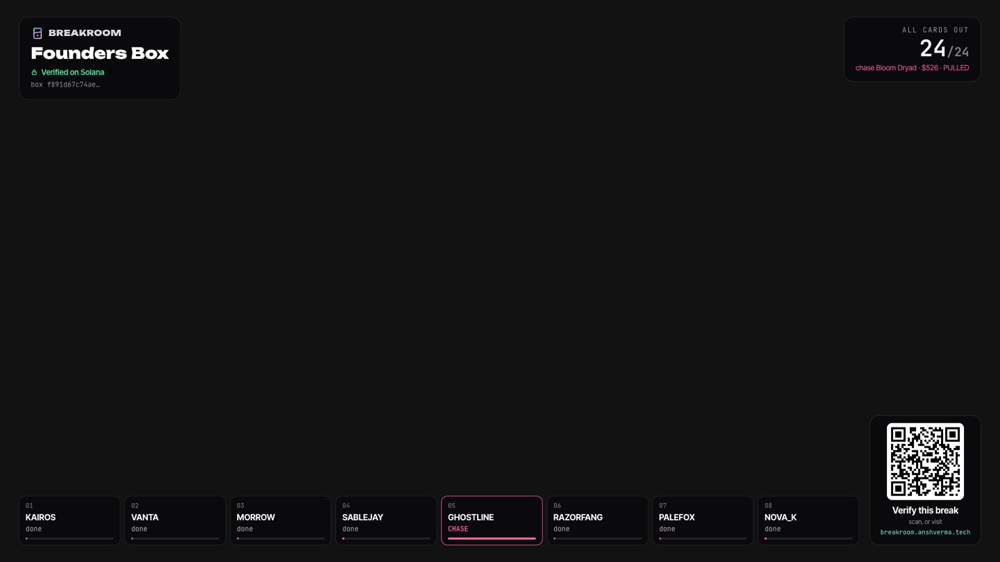

<p align="center">
  
</p>

<h2 align="center">Live card breaks you can verify, on Solana and MagicBlock</h2>

<p align="center">
  A host opens a sealed box live, buyers own the spots, and nobody can rig it: not the host, not us.<br>
  The box is locked on Solana, the shuffle is sealed inside MagicBlock's TEE, and every card can be checked afterwards.
</p>

<p align="center">
  <a href="https://breakroom.anshverma.tech"></a>
  <a href="https://explorer.solana.com/address/7hnz4i1zaz3UPW1eNzpTonN5GeLRCyVMSnpk5tTHKzTD?cluster=devnet"></a>
  <a href="#how-it-uses-magicblock"></a>
</p>

<p align="center">
  
  
  
  
  
  
</p>

<p align="center">
  
</p>

A **card break** is how collectors share a sealed box. A host opens it live on stream, and each buyer owns a *spot* that gets some of the cards. It's a big part of the hobby, and it all runs on trust: buyers have to believe the host didn't swap cards, leak the packs, fake the pulls or shill the auction.

BREAKROOM runs the whole break on chain. The box is **hashed on Solana** before a spot sells. **MagicBlock VRF** shuffles it into a **sealed account inside a Private Ephemeral Rollup** (Intel TDX) that nobody can read, the host included. A **crank** opens the packs live, you can **rip your own pack**, and spots **trade while the packs open**. At the end, a **Magic Action** writes who got every card to Solana, and anyone can re-run the shuffle in their browser.

| | |
|---|---|
| Try it | **[breakroom.anshverma.tech](https://breakroom.anshverma.tech)**: public test on devnet, free test SOL and USDC in the app, no real money |
| Program (devnet) | [`7hnz4i1zaz3UPW1eNzpTonN5GeLRCyVMSnpk5tTHKzTD`](https://explorer.solana.com/address/7hnz4i1zaz3UPW1eNzpTonN5GeLRCyVMSnpk5tTHKzTD?cluster=devnet) |
| TEE validator | [`MTEWGuqxUpYZGFJQcp8tLN7x5v9BSeoFHYWQQ3n3xzo`](https://explorer.solana.com/address/MTEWGuqxUpYZGFJQcp8tLN7x5v9BSeoFHYWQQ3n3xzo?cluster=devnet) (`devnet-tee.magicblock.app`) |
| Test USDC mint | [`373bamXfJ14k3JvwRnnX6CpfSqjuWSY5cfMcuPBHrCzV`](https://explorer.solana.com/address/373bamXfJ14k3JvwRnnX6CpfSqjuWSY5cfMcuPBHrCzV?cluster=devnet) (a PDA with an on-chain faucet) |
| Live proof | Every finished break has a **Verify** page that re-runs its shuffle in your browser |
| Security | How money moves and what you still have to trust: [SECURITY.md](SECURITY.md) |

---

## How it works



1. **Lock the box.** The host creates a break, moves each card NFT from their wallet into the **program's vault** (`deposit_card`), and seals it. `seal_break` hashes every card and its appraised value into a **commitment** and hands the break to the TEE validator. From here on the host can't touch the cards.
2. **Sell the spots.** `open_sale` creates three ephemeral accounts inside the TEE: the **Deck** (sealed, zero readers), the **Bids** (sealed, zero readers) and the **Chat** (public). Buyers pay from their **private USDC** balance. Fixed price is first come, first served. An auction takes **sealed bids**, and the winner pays the second-highest bid.
3. **Shuffle.** `start_break` asks **MagicBlock VRF** for a seed and schedules a **crank**. The VRF callback (`on_shuffle`) shuffles the box straight into the sealed Deck. If VRF is late, `fallback_shuffle` seeds it inside the TEE after 45 s, and the break is flagged.
4. **Open live.** The crank calls `reveal` every few seconds. Before each pack, the spot's owner gets an **8-second window to rip it themselves** (`rip`). If they don't, the crank opens it. Meanwhile every spot can be **listed, offered on and bought** with live chase odds.
5. **Settle.** After the last card, the crank's `finish` flips the Deck public and commits the break with a **Magic Action** that writes the **Receipt** on Solana: who gets every card.
6. **Deliver and verify.** Anyone can call `claim` to move a card from the vault to the wallet the Receipt names. Anyone can open the Verify page and re-run the shuffle from the public seed.

### Nobody can hold a break hostage

| If… | Then |
|---|---|
| every spot sold and the host stalls | anyone can start the break **5 minutes** after the last spot sold |
| some spots sold and the host stalls | the host picked a **start deadline** when creating the break (1 h, 6 h, 1 day or 3 days). Buyers see it on the break as a countdown. Once it passes, any buyer can start the break, and unsold spots go to the host |
| VRF doesn't answer | after 45 s anyone can seed the shuffle inside the TEE; the Deck stays sealed and the break is flagged |
| a buyer doesn't rip their pack | the crank opens it when the 8 s window ends |
| the crank is late | anyone can push the next `reveal`, or re-send settlement |
| a winner never comes back | anyone can `claim` their cards to them |

<p align="center">
  
</p>

---

## How it uses MagicBlock

Take any one of these out and the break stops being fair or stops being live.

| Building block | What it does in BREAKROOM | Code |
|---|---|---|
| **Private Ephemeral Rollup** (TEE) | Runs the sale, the spot market and the reveals, fast and gasless, with the sensitive state hidden | `instructions/{sale,market,live}.rs` |
| **Ephemeral permissions** | The Deck and the Bids have **zero members**, so nobody can read them. `close_auction` unseals the Bids and `finish` unseals the Deck | `sale.rs` `open_sale`, `live.rs` `finish` |
| **Ephemeral accounts** | Deck, Bids and Chat exist only inside the rollup, rent paid by the Break PDA. The card order never touches public Solana | `sale.rs` `open_sale` |
| **VRF** | One seed per break, delivered by callback into the sealed Deck | `live.rs` `start_break`, `on_shuffle` |
| **Crank** | One scheduled task reveals every card **and** settles the break. There is no server anywhere | `live.rs` `start_break` → `reveal` + `finish` |
| **Magic Action** | The post-commit `settle` on Solana writes the Receipt and the stats, with no extra user transaction | `live.rs` `finish`, `settle.rs` `settle` |
| **Private Payments API** | Deposits and withdrawals into private USDC balances inside the TEE | `app/src/chain/client.ts` `deposit` / `withdraw` |
| **Session keys** | One signature approves a spending limit for a browser key; every buy, bid, trade and rip after that is silent | `profile.rs`, `client.ts` `startSession` |

### Who can read what

| | You | Other buyers | The host | Anyone · RPC | After the break |
|---|:-:|:-:|:-:|:-:|:-:|
| Break: spots, owners, cards already out, odds | ✓ | ✓ | ✓ | ✓ | ✓ |
| Box commitment (the hash) | ✓ | ✓ | ✓ | ✓ | ✓ |
| Deck: the order of every unopened card | ✕ | ✕ | ✕ | ✕ | ✓ |
| Bids: auction amounts | ✕ | ✕ | ✕ | ✕ | ✓ (after the close) |
| Your private USDC balance | ✓ | ✕ | ✕ | ✕ | ✓ (you only) |
| Chat | ✓ | ✓ | ✓ | ✓ | ✓ |

### A finding that shaped the design

Inside the private rollup, the TEE gateway **refuses any transaction that hands a private token account to a program other than the SPL token program**, even when the owner signs it. Plain SPL transfers between private balances are allowed.

So BREAKROOM never holds anyone's money. Every paid action is the buyer's own transfers followed by a program instruction that checks them:

```
[ SPL transfer  buyer → host      (price − fee) ]
[ SPL transfer  buyer → treasury  (fee)         ]
[ breakroom::buy_spot                            ]   ← reads the instructions sysvar and checks both transfers
```

(`programs/breakroom/src/pay.rs`). Hosts are paid the moment a spot sells, and sellers the moment a trade fills.

---

## The product

<p align="center">
  
</p>

| | |
|---|---|
| **Two formats** | *Packs*: every spot owns one sealed pack, and packs open one by one. *Random teams*: VRF deals the 8 Genesis elements across the spots, and every card of your element is yours (like a sports-card "random teams" break) |
| **Two ways to sell** | *Fixed price*: same price for everyone, first come first served. *Sealed auction* (2 min, 10 min or 1 h): bids are hidden in the TEE, and the winner pays the second-highest bid, so there's nothing to shill against |
| **Start deadline** | The host picks how long they have to start. Buyers see it as a countdown, and can start the break themselves if the host misses it |
| **Rip your own pack** | When your pack is up, the camera moves in and you drag across the seal to tear it open. Only the timing is yours: the card was fixed by the VRF shuffle |
| **Trade mid-break** | List a spot, make an offer, or buy a listed spot while packs are opening, with live chase odds and expected value per spot (2% fee) |
| **Instant buyback** | Sell a delivered card to the desk's pool for 85% of its appraised value, in one transaction on Solana |
| **Real trading cards** | The Genesis set: 8 elements, 5 rarities, grade, power, ability and flavor text, drawn from each card's on-chain appraisal. Original art, no third-party IP |
| **Pull Clips** | Your own rip is recorded in the browser as a 9:16 video with the pull and the proof, ready to share |
| **Stream overlay** | A transparent page for OBS: the sealed-box proof, live spots and chase odds, each card as it comes out, and a QR code to join or verify. It turns any Twitch or YouTube break into a verifiable one |
| **Vault** | Your cards, open spots, hosted breaks, history and activity |
| **Profiles** | A collector name in the rollup, generated avatars, or your own picture (wallet-signed upload) |
| **Leaderboard** | Biggest pulls, top collectors and host stats, computed from chain data with no indexer |
| **Chat** | Live room chat and reactions in the rollup, free and instant |
| **Sound** | Background music (on by default, with options) and effects, all switchable in Settings |

<p align="center">
  
  
</p>
<p align="center">
  
  
</p>
<p align="center">
  
</p>

| Screen | What's there |
|---|---|
| Home | Join a live break or host one, live stats, the latest box commitment with a link to verify it |
| Live breaks | Every break on sale, live or finished, with spots left and box value |
| Room | The 3D table, packs, the rip, the chase card, spots with live odds, the market, chat, the box and activity |
| Host | Pick cards (or mint a free demo box on devnet), format, sale type, start deadline, spots, price and reveal speed, then launch |
| Verify | The box commitment, sealed-before-sale check, the shuffle re-run in your browser, the opening order, the seed source and the Solana receipt |
| Vault | Your cards (keep or sell back), spots, hosted breaks, history, activity, profile picture |
| Account setup | Five steps, about a minute: test SOL, test USDC, private deposit, collector name, one-tap session |

---

## Verified on devnet

- `scripts/e2e.ts`: the full lifecycle against the live TEE. Private deposits, a paid buy, a forged or underpaid payment rejected, resale, an accepted offer, the VRF shuffle, the Deck sealed while live, crank reveals, the Deck unsealed, the shuffle re-run, the box commitment checked, Magic Action settlement and delivery.
- `scripts/e2e_modes.ts`: the sealed auction (counts public, amounts sealed, second price, bids unsealed after the close, the loser can't take the winner's spot), random teams, chat and buyback.
- `scripts/e2e_rip.ts`: the rip window opens before each pack, the owner rips it, a stranger can't, and a pack nobody rips is opened by the crank.
- `scripts/e2e_deadline.ts`: a break with no deadline is rejected, the host's pick becomes a deadline when the sale opens, a buyer can't start early, and after the deadline a buyer starts it and unsold spots go to the host.
- `scripts/check_shuffle.ts`: the browser verifier matches the program's shuffle bit for bit.
- `scripts/ui-flow.mjs`: clicks through the real UI as a new user, from setup to buying and listing a spot.
- `cargo test --lib`: the shuffle is a permutation and deterministic, plus the account layout and a test vector.

## Repository

```
programs/breakroom/src
  lib.rs              the list of instructions (thin: each calls its handler)
  constants.rs        addresses, fees, timings, limits
  state.rs            Break (zero-copy), Deck (sealed), Bids, Chat, Receipt, Card, Profile, Stats
  pay.rs              non-custodial payment checks (instructions sysvar)
  instructions/       admin · host · profile · sale · market · live · settle
app/src
  chain/              client (Solana + TEE + Payments API), account decoders, shuffle verifier
  scene/              Three.js: the table, packs and the rip, cards, holo foil, slabs
  pages/              Home · Lobby · Room · Host · Vault · Verify · How · Leaders · Overlay
  ui/                 shell, connect, account setup, settings, avatars, tiles
  lib/                card art, odds, music, sound, Pull Clips, profile pictures, break data
avatar-worker/        Cloudflare Worker + KV for profile pictures (wallet-signed)
scripts/              deploy, setup, seed, bots, market and e2e tests
docs/assets/          README images
```

## Run it

The app talks to the live devnet program and needs no backend. You only need Node 22+:

```bash
npm install
npm run dev            # http://localhost:5173
```

To work on the program you also need Rust, the Solana CLI and Anchor:

```bash
cargo test --lib                    # shuffle + layout
npx tsx scripts/check_shuffle.ts    # browser verifier == program
./scripts/deploy.sh                 # cargo build-sbf + anchor idl build, deploy, check the deployed bytes
npx tsx scripts/e2e.ts              # full lifecycle on devnet + TEE
```

| Script | |
|---|---|
| `scripts/deploy.sh` | build, extend program data if needed, deploy, check the deployed bytes match |
| `scripts/setup.ts` | one-time: stats, test USDC, Payments API mint on the TEE, treasury balance |
| `scripts/seed.ts` | mint and list a Genesis box (`--fill` bots buy, `--start` runs it) |
| `scripts/market.ts` | bot collectors trade a live break's spots off expected value |

Deploying your own copy needs your own program id and admin key: see [CONTRIBUTING.md](CONTRIBUTING.md).

## Limits

- **Devnet, test money.** The public test uses devnet SOL, test USDC and original Genesis demo cards. Real graded cards and mainnet come next.
- **The TEE is the trust anchor.** The sealed Deck and Bids rest on MagicBlock's Intel TDX validator and its permission checks.
- **Appraisals are a desk.** Card values come from the appraisal desk, not the host. On mainnet that's where tokenized graded cards plug in.
- **No refunds after a sale.** Buyers pay the host directly at the moment of sale, so the program never holds money to refund. That's why stalled breaks are *started*, not cancelled: buyers always get their packs.

## Contributing

Bug reports and pull requests are welcome: [CONTRIBUTING.md](CONTRIBUTING.md). Found a way to rig a break or move someone else's money? Please report it privately, as described in [SECURITY.md](SECURITY.md).

## License

The code is [MIT](LICENSE). The Genesis card art is generated by the app's own code and is covered by the same license.
